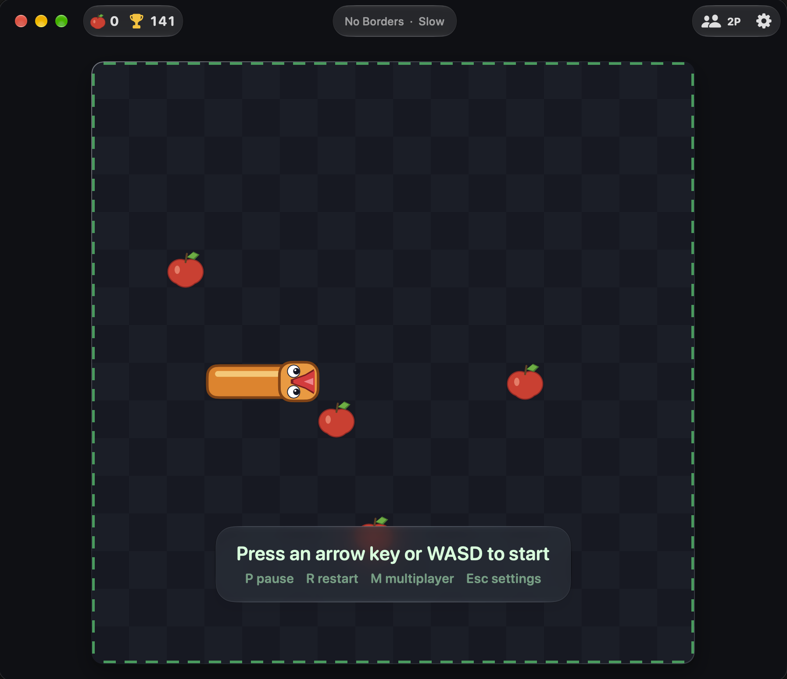

A native Snake game for the Mac, written in Swift and SwiftUI. It plays alone or with up to four people on the same Wi-Fi, and it is compatible with the [Windows version](https://github.com/Daniel-the-Boehm/snake-windows): a Mac can host a game that Windows players join, and the other way round.

There is no Xcode project. The whole app is ten Swift files and one build script.

## Features

- Seven game modes
- Local multiplayer for two to four players with automatic discovery on the network
- Four map sizes, four speeds and up to 144 apples on the board at once
- Four colour themes and four snake styles
- Your own pictures as background, snake head or fruit: drag an image into the window
- Settings and high scores are saved between sessions
- Uses the Liquid Glass look on macOS 26 and falls back to standard materials on macOS 15

## Game modes

| Mode | Rule |
| --- | --- |
| Classic | Solid borders. Hit a wall or yourself and the round is over. |
| No Borders | The edges wrap around. |
| Wall | Every apple turns the end of your tail into a permanent wall. |
| Twin | After each apple, head and tail swap and you move the other way. |
| Mirror | Left and right are swapped. |
| Rush | The more you eat, the faster you go. |
| Apple | You play the apple. Alone, a computer-controlled snake hunts you. With friends, they are the snakes and have 60 seconds to catch you. |

## Build

Requirements: macOS 15 or later and the Xcode Command Line Tools (`xcode-select --install`).

```
./build_mac.sh
```

The script compiles the sources, signs the app ad hoc and creates `build/Snake.app` and `Snake.dmg`. Because the app is not notarised, macOS asks for confirmation on first launch: right-click the app and choose Open.

## Controls

| Key | Action |
| --- | --- |
| Arrow keys or WASD | Start and steer |
| P | Pause |
| Backspace | Restart |
| R | Teleport in Apple mode, three per round |
| Esc | Settings |
| M | Multiplayer |
| Space or Enter | Play again |

## Multiplayer

One player hosts, the others join. All devices have to be on the same network; guest networks usually block devices from seeing each other. On first use macOS asks for permission to access the local network.

The game uses TCP port 55055 for the match and UDP port 55056 to find hosts. If discovery fails, enter the host's IP address by hand in the join screen.

## Project layout

| File | Purpose |
| --- | --- |
| `Sources/SnakeApp.swift` | App entry point and menu commands |
| `Sources/AppModel.swift` | Input handling, game flow, lobby and round logic |
| `Sources/Game.swift` | Rules for all modes and the computer-controlled snake |
| `Sources/Net.swift` | Sockets for hosting, joining and discovery |
| `Sources/Renderer.swift` | Drawing of board, snakes and fruit |
| `Sources/Views.swift` | SwiftUI screens and settings |
| `Sources/Glass.swift` | Liquid Glass helpers with fallback |
| `Sources/Photos.swift` | Import of custom pictures |
| `Sources/Config.swift` | Settings and high scores |
| `Sources/Constants.swift` | Themes, modes, sizes and shared helpers |

Saved data lives in `~/Library/Application Support/Snake`.
